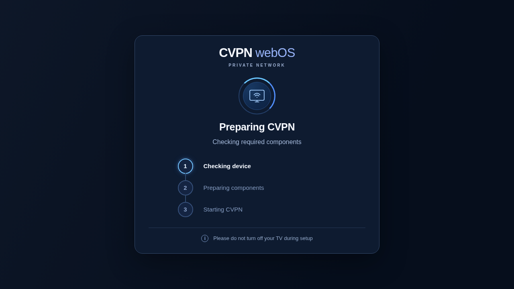
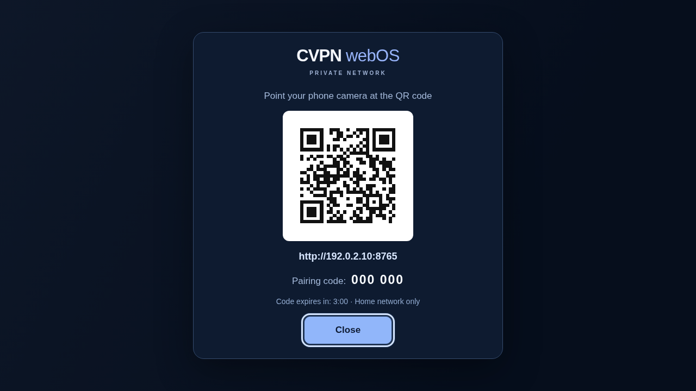
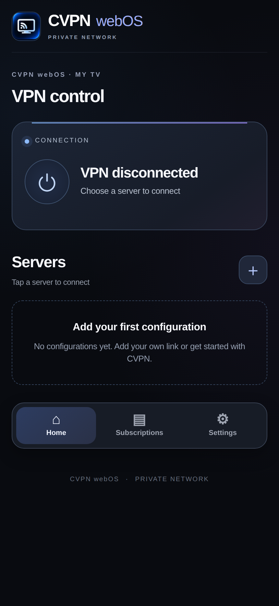
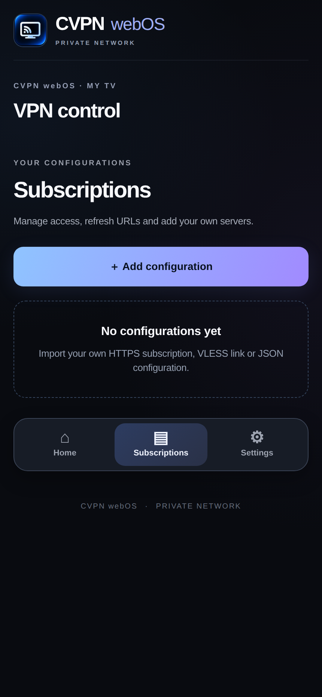
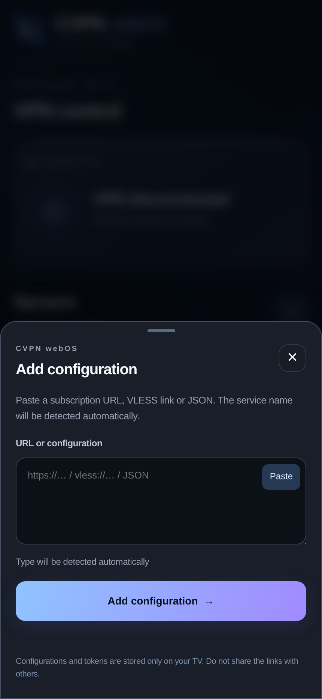
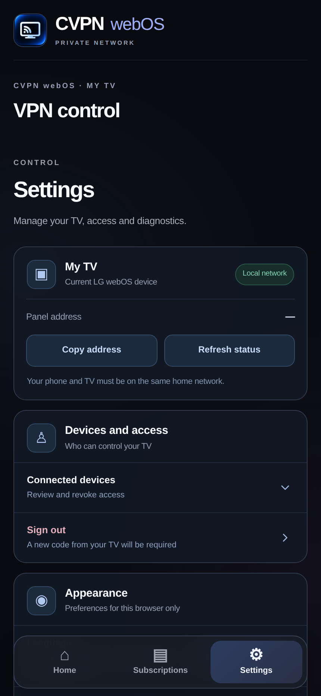

  
  <h1>CVPN webOS</h1>
  
<strong>Xray / VLESS VPN for rooted LG webOS TVs</strong>

  
<strong>Import Xray configs. Connect with TCP, XHTTP or gRPC.</strong> 
  VLESS links, HTTPS subscriptions and supported Xray JSON — managed from your phone.

  
<strong>Free to use · No CVPN account required · English & Russian</strong>

  

    <a href="https://github.com/mikemandi/cvpn-webos/releases/tag/v2.2.6"><strong>Download v2.2.6 IPK</strong></a>
    &nbsp;·&nbsp; <a href="#installation">Installation</a>
    &nbsp;·&nbsp; <a href="#compatibility">Compatibility</a>
    &nbsp;·&nbsp; <a href="#troubleshooting">Help</a>
    &nbsp;·&nbsp; <a href="CHANGELOG.md">Changelog</a>
  

  
<strong>English</strong> · <a href="README.ru.md">Русский</a>

  
<strong>Official guide:</strong> <a href="https://cvpn.su/en/guides/lg-webos/">English installation guide</a> · <a href="https://cvpn.su/guides/lg-webos/">Русская инструкция</a>

---

## Overview

**CVPN webOS** is an **Xray/VLESS VPN client for rooted LG webOS TVs**. Import your compatible Xray configuration, choose **TCP, XHTTP or gRPC**, and control the connection from your phone over your trusted home network. The VPN engine runs on the TV itself. **TCP, XHTTP and gRPC are Xray transports, not three separate VPN protocols.**

- **All-in-One:** TV launcher, ARMv7 backend, Xray-core and recovery scripts in a single IPK. Nothing else needs downloading during TV setup.
- **Xray transport support:** **TCP · XHTTP · gRPC** for compatible VLESS configurations. Reality is supported; gRPC also supports TLS. Transport and security settings must match your server.
- **Your Xray configs:** import `vless://` links, compatible HTTPS subscriptions or supported Xray JSON configurations. Bring your own provider — a CVPN subscription is optional.
- **TV pairing:** open the app on LG, scan the QR and enter a short-lived PIN if prompted.
- **Simple control:** English/Russian interface, server selection, subscription import, device access and diagnostics from your browser.
- **Recovery-focused:** checks and safeguards around system prerequisites, component upgrades and VPN sessions.

> [!IMPORTANT]
> The app is free, but **you need a compatible VPN endpoint or configuration to connect**. You do **not** need a CVPN subscription. Root and a compatible Homebrew installation are required; this is **not** an LG Content Store app.

## Screenshots

  
  
<strong>TV setup:</strong> automatic component preparation with a simple progress view.

  
  
<strong>TV pairing:</strong> scan QR or use the PIN from the local network.

<table>
  <tr>
    <td align="center" width="50%"></td>
    <td align="center" width="50%"></td>
  </tr>
  <tr><td align="center"><b>Home · No VPN configured</b></td><td align="center"><b>Subscriptions · Empty state</b></td></tr>
  <tr>
    <td align="center"></td>
    <td align="center"></td>
  </tr>
  <tr><td align="center"><b>Import · Blank input</b></td><td align="center"><b>Settings · Local controls</b></td></tr>
</table>

These screenshots use the **actual application markup, styling and bundled icons**, rendered in a deterministic offline demo state. No real VPN sessions, saved configurations, accounts, keys or private addresses are included. The pairing image uses a **non-functional example code and RFC 5737 reserved TEST-NET IP**, not a live TV pairing session. See <a href="scripts/capture-docs-screenshots.cjs">screenshot capture script</a>.

## Installation

### Requirements

- An LG TV with **root** and a compatible **Homebrew Channel root service**.
- **ARMv7-compatible 32-bit userspace**, including supported aarch64 kernels running a compatible 32-bit userspace.
- A functional **/dev/net/tun**, sufficient application storage, and working home networking.
- A phone/computer on the **same trusted LAN**.

### Steps

1. Download **<a href="https://github.com/mikemandi/cvpn-webos/releases/tag/v2.2.6">su.cvpn.webos_2.2.6_all.ipk</a>** and check it against the release's SHA256SUMS.
2. Install the IPK on your rooted LG TV with your Homebrew/IPK installation tool.
3. Launch **CVPN webOS**. The app automatically checks and prepares its bundled components on first run.
4. Open the TV pairing screen, scan the QR from your phone and enter the temporary PIN if needed. Your phone and TV must be on the same trusted network.
5. In **CVPN Connect** on your phone, go to **Subscriptions → Add configuration**. Import your compatible HTTPS subscription, VLESS/Reality link or supported Xray configuration.
6. Select your server, connect and confirm the connection if a confirmation window appears.

**Upgrading:** disconnect VPN before installing the new IPK over the old app. Keep your existing backend data directory: it stores local profiles and pairing settings. The installer refuses to replace binaries while VPN routes, TUN or related processes are active.

## How it works

| Component | Responsibility |
|---|---|
| **TV launcher 2.2.6** | Preparation, progress/errors and QR pairing |
| **CVPN Connect** | Local browser control for VPN, profiles, settings and devices |
| **VPN Engine 0.1.4** | TUN/network setup and connection lifecycle |
| **Xray-core 26.10.21** | Bundled ARMv7 VPN transport engine |
| **Backend 2.0.0** | Local API, pairing and session management |

The control panel uses **HTTP port 8765** for **trusted private LAN access only**. Do not forward it in your router or expose it publicly.

## Compatibility

**Owner-tested on four LG TVs:** **55UK6450PLC (webOS 4.4.3-22)**, **65UK6710PLB (4.4.3-22)**, **86NANO906NA (5.6.2)** and **55UQ76003LD (webOS 22 / 7.6.0-1901)**. Earlier logs detail successful VPN connectivity, Xray/TUN and DNS/route checks on several models; the owner confirms CVPN works on all four. The degree of documented testing differs by model — see the [device evidence table](docs/TESTED_DEVICES.md).

**Earliest tested webOS build: 4.4.3-22.** The Homebrew catalog is limited to webOS **4.4+** as a conservative filter; it does not certify every 4.4.x release. **Version 2.2.5** TV layout and remote navigation were additionally confirmed on LG hardware. Root, Homebrew service, 32-bit userspace and TUN remain mandatory.

See [tested devices](docs/TESTED_DEVICES.md), [hardware QA](docs/QA_ACCEPTANCE_2.2.2.md) and [technical limitations](docs/RELEASE_LIMITATIONS.md).

## Security & limitations

| Topic | Current behavior |
|---|---|
| Root | Required for TV-wide VPN; unrooted LG TVs are unsupported |
| IP routing | IPv4-only; active IPv6 default routes cause the VPN connection to be refused |
| Kill switch | No universal kill switch; ordinary internet is restored after disconnect/failure |
| TV restart | VPN does **not** autoconnect on boot |
| Local panel | HTTP on the trusted LAN only — no public port forwarding |
| Secrets | Never publish subscription URLs, UUIDs, pairing tokens or raw support logs |
| Protocol support | A valid imported profile may still depend on provider/server/network compatibility |

For full details, read [Security](docs/SECURITY.md) and [Limitations](docs/RELEASE_LIMITATIONS.md).

## Troubleshooting

<strong>Preparation fails or keeps checking</strong>

Verify root, Homebrew Channel, 32-bit ARMv7 compatibility and TUN. Disconnect an active VPN before an update. If an installer is already working, leave it to finish instead of starting another.

<strong>The QR does not open on my phone</strong>

Check that both devices are on the same trusted LAN, and that guest/client isolation is disabled. You can type the local address displayed on the TV manually. Pairing codes expire and are one-time use; open the TV app again to obtain a fresh one.

<strong>There are no servers in the app</strong>

This is normal on a fresh installation. Go to **Subscriptions → Add configuration** and import a compatible VPN configuration or subscription from the provider of your choice. No default subscription is included.

<strong>VPN is connected, but an app does not load</strong>

Try another compatible server, fully restart the affected TV app, or check **Settings → Diagnostics**. Review IPv6 and DNS requirements and follow safe network recovery guidance. Do not send raw logs containing tokens or UUIDs.

[Security guide](docs/SECURITY.md) · [Known limitations](docs/RELEASE_LIMITATIONS.md) · [Report an issue](https://github.com/mikemandi/cvpn-webos/issues)

## Build & test

For Linux Bash, with the Go version and Linux dependencies specified in [CI](.github/workflows/ci.yml):

~~~bash
bash scripts/build-release.sh
bash tests/run_offline.sh
~~~

For Windows, run the same scripts inside WSL:

~~~powershell
wsl bash scripts/build-release.sh
wsl bash tests/run_offline.sh
~~~

The All-in-One IPK is created in the **dist/** directory. CI checks the ARMv7 build, packaging, tests, launcher and installer safeguards.

## Source license and publication

**CVPN webOS is free to install and use** under the [CVPN proprietary license](LICENSE) ([Russian translation](docs/legal/CVPN_TERMS_RU.md)). You may run the app with any compatible provider, keep personal backups and privately examine/build the project code, but you may not publicly redistribute or rebrand CVPN-owned code without permission. The [brand policy](BRAND_POLICY.md) protects original names and icons while allowing factual reviews and official Homebrew listings. The app is **not open-source**; Homebrew uses **`pool: non-free`**, which refers to licensing, not price. Xray-core (MPL-2.0) and QR libraries (MIT/Apache-2.0) retain their separate rights; see [third-party notices](THIRD_PARTY_NOTICES.md). The v2.2.6 IPK includes the CVPN proprietary license and third-party notices. Earlier v2.2.5 release assets remain unchanged.

Development involved AI-assisted implementation and testing, followed by project-owner review and real LG testing. Inclusion in the Homebrew Channel catalog is subject to a separate upstream maintainer submission and approval.

[Homebrew submission](docs/HOMEBREW_SUBMISSION.md) · [Licensing review](docs/legal/LICENSING_REVIEW.md) · [LICENSE](LICENSE) · [Brand policy](BRAND_POLICY.md) · [Third-party notices](THIRD_PARTY_NOTICES.md) · [Лицензия на русском](docs/legal/CVPN_TERMS_RU.md)
