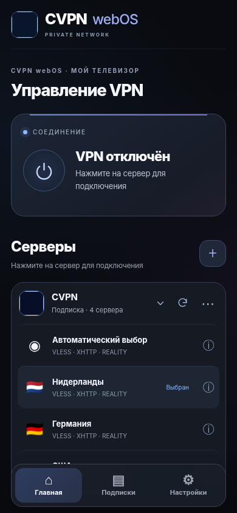
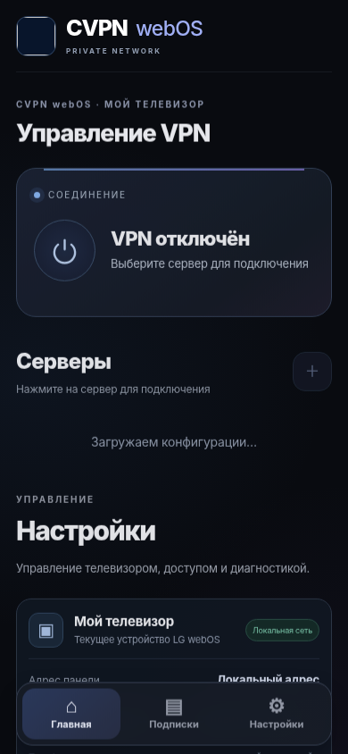
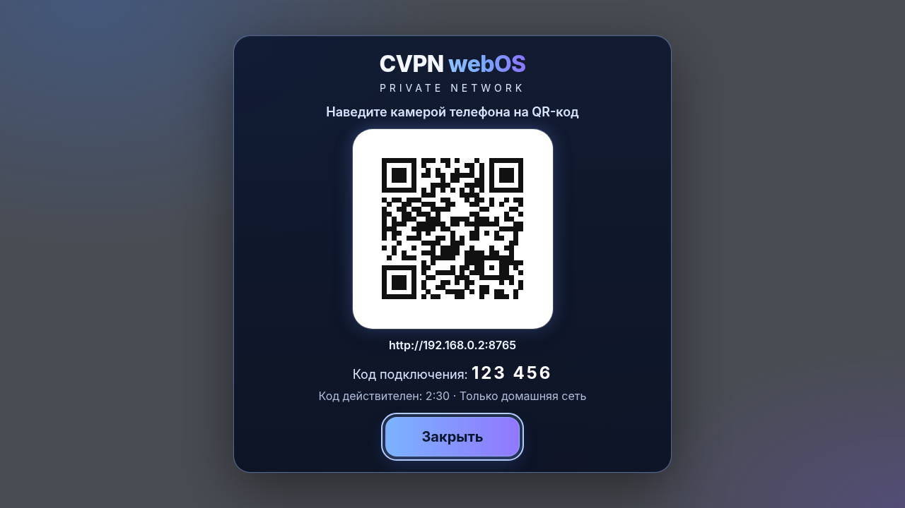

<div align="center">


# CVPN webOS

**PRIVATE NETWORK · CVPN Connect**

A privacy-focused VPN control experience for **rooted LG webOS TVs**. Pair your phone with your TV, import your own VLESS servers or HTTPS subscription and control the connection from a clean, mobile-friendly dashboard.

   

[Website](https://cvpn.su) · [Downloads](../../releases) · [Installation](#installation) · [Safety](docs/SECURITY.md)

</div>

---

## Overview

CVPN webOS contains **two separately installed components**:

| Component | Version | Purpose |
|---|---|---|
| **TV Launcher (IPK)** | 2.0.4 | Opens the pairing QR code on the television and notifies the control panel. |
| **Root backend + VPN Engine** | 2.0.0 / 0.1.4 | Manages local profiles, subscriptions, Xray and the network TUN. |

**Installing the IPK alone does not establish a VPN.** A supported rooted TV and the separate root setup are required. There is no remote account syncing: each television stores its own subscriptions locally.

## Interface

> Images below are **historical design previews** from the development series. Obtain current real-device screenshots before submitting the store listing.

<div align="center">
  
  
  
</div>

## Features

- QR/PIN pairing directly on the LG television, administration from a phone on the same trusted LAN.
- VLESS/Reality/XHTTP/gRPC support according to installed Xray version and verified configurations.
- Import configurations and HTTPS subscriptions; keep secrets on each television, not in a shared cloud.
- TV network routing on supported Ethernet and Wi-Fi interfaces.
- 90-second connection trial, recovery worker and no automatic VPN connection at boot.
- Russian/English mobile UI, subscription grouping, connection diagnostics and session management.

## Requirements

**This is Homebrew software, NOT an application for the regular LG Content Store.**

- Rooted LG television with ARMv7 32-bit userspace. Both `armv7l` kernels and compatible `aarch64` kernels reporting `getconf LONG_BIT=32` are accepted by the bootstrap; runtime compatibility still requires device testing.
- Installed Homebrew Channel startup integration (`/var/lib/webosbrew/startup.sh`).
- Root SSH access, available `ip`, `curl`, `sha256sum`, `od` and TUN support.
- **Compatible Xray-core ARMv7 binary** preinstalled under `/media/developer/cvpn-webos/bin/xray`, or provided explicitly during the first installation.
- Trusted home network. Local control uses HTTP (`:8765`) and **must never be exposed to the internet**.

IPv6 is not tunneled: Engine refuses to connect when an IPv6 default route could allow traffic leakage. See [Known limitations](docs/RELEASE_LIMITATIONS.md).

## Installation

### 1. Download

Create the release from this repository's GitHub Actions, or download the published GitHub Release assets:

- `su.cvpn.webos_2.0.4_all.ipk` — the TV launcher.
- `cvpn-webos-root-2.0.0.zip` — TV backend, Engine, recovery and first-time installer.
- `su.cvpn.webos.manifest.json` — Homebrew Channel release manifest.

Do **not** use the historic `All.zip` development archive — it may contain private keys.

### 2. Install the root backend (first-time setup only)

Extract `cvpn-webos-root-2.0.0.zip`. Do not run this over an existing CVPN installation; it deliberately refuses existing data instead of overwriting subscriptions.

**Windows PowerShell:**

```powershell
Set-ExecutionPolicy -Scope Process -ExecutionPolicy Bypass -Force
.\scripts\setup.ps1 -TV 192.168.1.50 -Action check
.\scripts\setup.ps1 -TV 192.168.1.50 -Action install -XrayPath 'C:\path\to\xray-armv7'
.\scripts\setup.ps1 -TV 192.168.1.50 -Action doctor
```

**Linux Bash:**

```bash
bash scripts/setup.sh 192.168.1.50 check
bash scripts/setup.sh 192.168.1.50 install /path/to/verified/xray-armv7
bash scripts/setup.sh 192.168.1.50 doctor
```

Change the IP to your television's actual LAN IP. Supply Xray from an [official Xray-core release](https://github.com/XTLS/Xray-core/releases); verify it on your hardware. Root backend installation does not change routes or DNS and does not automatically connect to a VPN. See [Xray requirements](docs/XRAY.md).

### 3. Install the TV launcher (IPK)

Use **Homebrew Channel** (once the application is accepted into its repository), or use official webOS tooling to install the IPK manually:

```bash
ares-install --device <your-configured-TV-name> su.cvpn.webos_2.0.4_all.ipk
```

Launch CVPN webOS on the television, pair your phone via QR/PIN and import your *own* subscription.

### Existing RC5 / Stable TVs

The new-root setup script is **not** an updater. If your TV already runs the tested Stable backend 2.0.0, do not run it. Launcher 2.0.4 has been physically validated. The fresh backend installation on LG 55UQ76003LD worked after the first-import and BusyBox DNS timeout fixes; see [real-device test record](docs/TESTED_DEVICES.md).

## Build from source

CI builds with **Go 1.27.3** on Ubuntu; Xray-core is not embedded.

```bash
bash scripts/build-release.sh
bash tests/run_offline.sh
```

Output files are written to `dist/`. The IPK uses the webOS Debian package structure, verified with `dpkg-deb`. Validate installation on real target hardware before publishing.

## Homebrew Channel publishing

After creating your repository and a tagged GitHub release:

```bash
python3 scripts/make-manifest.py --repository OWNER/REPO --tag v2.0.2
python3 scripts/make-homebrew-entry.py --repository OWNER/REPO
```

The generated manifest must be uploaded to the **same GitHub Release** as the IPK, and the generated YAML must be proposed through a PR to [`webosbrew/apps-repo`](https://github.com/webosbrew/apps-repo). Read [the complete submission guide](docs/HOMEBREW_SUBMISSION.md).

## Security and licensing

The backend executes privileged network commands and cannot run as a regular sandboxed LG app. There is no independent external security audit. Never expose the local HTTP panel to public or hostile networks. Report vulnerabilities privately rather than publicly sharing private subscription URLs.

**License review required before publication:** source ownership and a project license have not been confirmed. Source visibility alone does not confer open-source status. For now, the Homebrew entry uses the `non-free` pool. QR-related Apache-2.0 notices are included; Xray-core is downloaded from its own official project and not included in this distribution. See [`LICENSE-PUBLISHING-REVIEW.md`](LICENSE-PUBLISHING-REVIEW.md).

<details>
<summary>Русское резюме</summary>

CVPN webOS — приложение для LG с root-доступом. Файл `.ipk` устанавливает только телевизионный интерфейс. Для работы VPN отдельно нужен backend, Engine и совместимый Xray. Подписки сохраняются отдельно на каждом ТВ. Через Homebrew Channel приложение станет доступно только после публикации релиза, подачи заявки и одобрения сопровождающими Homebrew. Перед отправкой необходимо проверить новую установку на реальном LG и подтвердить права на исходный код, библиотеку и изображения.

</details>


### Clean-install first-import repair (validated on LG 55UQ76003LD)

The initial clean-install package did not contain the trusted Xray TUN template.
A new TV could reject every imported profile even when Xray itself ran normally.
The updated backend now embeds a **secret-free** template and writes the active
`client.json` / `server-ip.txt` only when a validated server is selected.

To repair an **existing clean install** without disturbing Xray or VPN routes,
use `scripts/repair-first-import.ps1` with `-Action check`, then `-Action install`,
together with the **recompiled ARMv7 backend**. Keep the initial backup for rollback.
The original v2.0.1 GitHub Release does not include this fix. Wait for a verified newer tagged release before deploying the combined package.

## Release validation

See [tested LG devices and remaining checks](docs/TESTED_DEVICES.md). The packaged TV IPK is a launcher only; fresh installations must separately install root backend and a compatible Xray binary. Real-device screenshots must be sanitized before the Homebrew submission.
