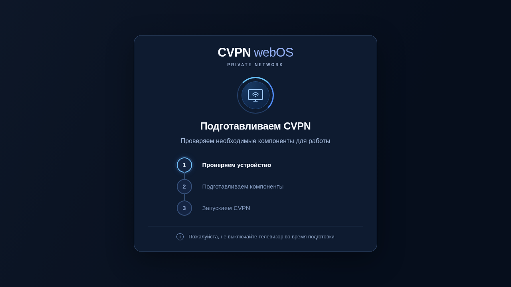
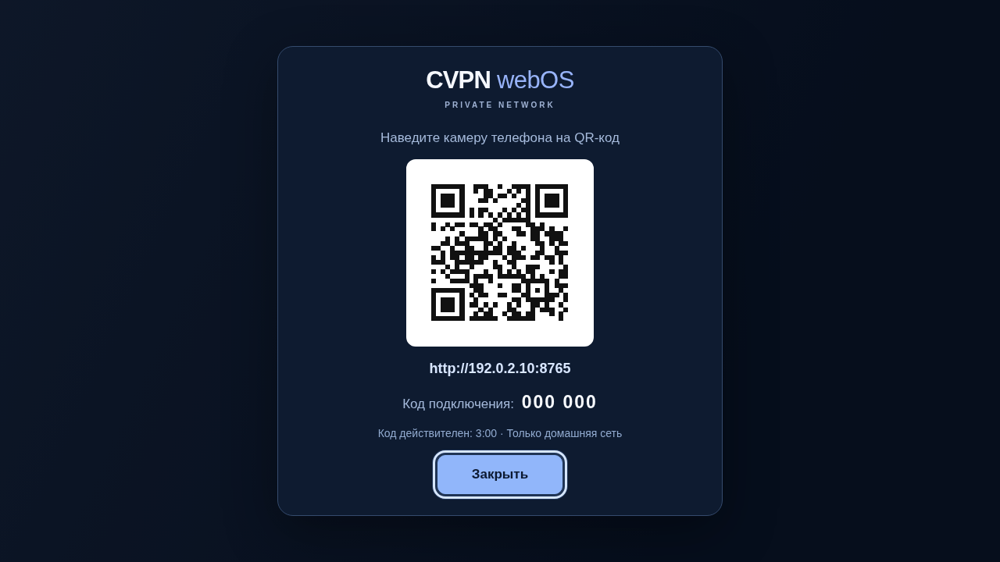
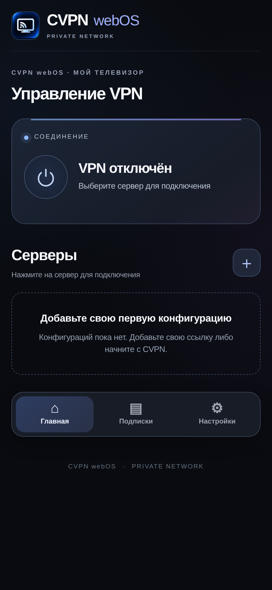
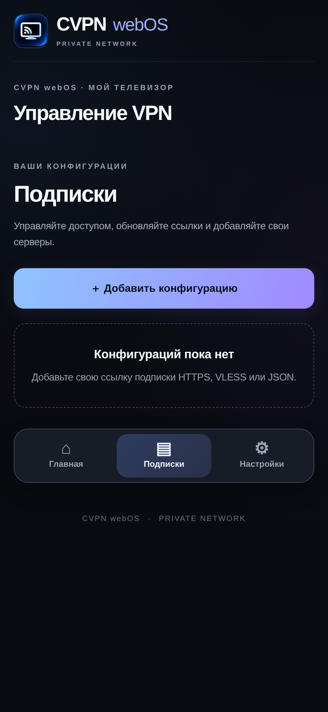
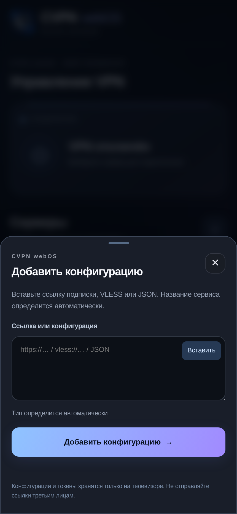
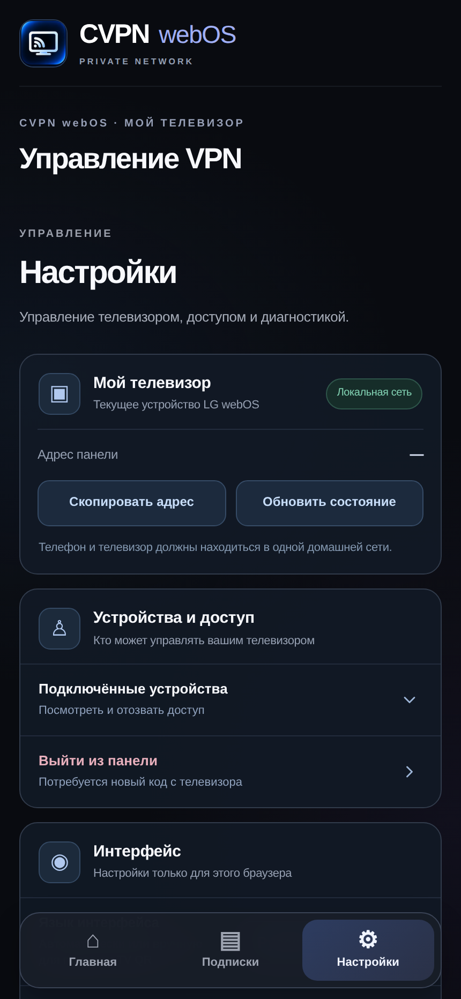

  
  <h1>CVPN webOS</h1>
  
<strong>Xray / VLESS для телевизоров LG webOS с root</strong>

  
<strong>Свои Xray-конфигурации. TCP, XHTTP и gRPC.</strong> 
  Импорт VLESS-ссылок, HTTPS-подписок и Xray JSON. Управление с телефона.

  
<strong>Бесплатно · Без обязательной подписки CVPN · Русский и английский</strong>

  

    <a href="https://github.com/mikemandi/cvpn-webos/releases/tag/v2.2.6"><strong>Скачать CVPN webOS 2.2.6</strong></a>
    &nbsp;·&nbsp; <a href="#установка">Установка</a>
    &nbsp;·&nbsp; <a href="#совместимость">Совместимость</a>
    &nbsp;·&nbsp; <a href="#частые-вопросы-и-ошибки">Помощь</a>
  

  
<strong>Русский</strong> · <a href="README.md">English</a>

---

## Что такое CVPN webOS

**CVPN webOS** — **Xray/VLESS-клиент для телевизоров LG с root и Homebrew Channel**. Импортируй собственные Xray-конфигурации, используй **TCP, XHTTP или gRPC** и управляй подключением с телефона через **CVPN Connect**. VPN работает непосредственно на телевизоре. **TCP, XHTTP и gRPC — транспорты Xray, а не три отдельных VPN-протокола.**

- **Всё в одном IPK:** Launcher, ARMv7-бэкенд, Xray-core и сценарии восстановления входят в установочный пакет. Не требуется вручную скачивать компоненты на ТВ при первом запуске.
- **Транспорты Xray:** **TCP · XHTTP · gRPC** для совместимых VLESS-конфигураций. Поддерживается Reality, а для gRPC также TLS. Параметры должны соответствовать серверу.
- **Свои Xray-конфигурации:** импорт `vless://`-ссылок, совместимых HTTPS-подписок и поддерживаемого Xray JSON. Можно использовать любого совместимого провайдера без подписки CVPN.
- **Подключение через QR:** запускаешь приложение на LG, сканируешь код телефоном и при необходимости вводишь одноразовый PIN.
- **Русский и английский:** локализованные меню, подключение, подписки, настройки, диагностика, подготовка и QR на экране телевизора.
- **Безопасная подготовка:** проверка необходимых компонентов, контроль целостности, защита от обновления активного VPN и попытка восстановления сети при сбое.

> [!IMPORTANT]
> **Само приложение бесплатно, но для работы VPN нужна совместимая конфигурация или подписка какого-либо провайдера.** Подписка CVPN, регистрация и оплата в CVPN не обязательны. Для установки нужен root и Homebrew — это **не приложение LG Content Store**.

## Скриншоты

  
  
<strong>Подготовка телевизора:</strong> автоматическая проверка и установка компонентов.

  
  
<strong>Сопряжение:</strong> QR-код и одноразовый PIN для телефона в домашней сети.

<table>
  <tr>
    <td align="center" width="50%"></td>
    <td align="center" width="50%"></td>
  </tr>
  <tr><td align="center"><b>Главная · VPN не настроен</b></td><td align="center"><b>Подписки · Пустой список</b></td></tr>
  <tr>
    <td align="center"></td>
    <td align="center"></td>
  </tr>
  <tr><td align="center"><b>Импорт · Без конфигурации</b></td><td align="center"><b>Настройки · Управление телевизором</b></td></tr>
</table>

Изображения получены из **настоящего HTML/CSS/JS приложения с оригинальными иконками**, но в изолированном демонстрационном режиме: нет реальных серверов, учётных записей, подключений и приватных ключей. Для иллюстрации QR применяется **нерабочий PIN и адрес 192.0.2.10 из зарезервированного тестового диапазона**. Их нельзя использовать для подключения. Скриншоты можно пересоздать скриптом <a href="scripts/capture-docs-screenshots.cjs">capture-docs-screenshots.cjs</a> с параметром --lang=ru.

## Установка

### Что понадобится

- Телевизор **LG webOS с root** и совместимой службой Homebrew Channel.
- **32-битное пользовательское окружение ARMv7**, включая совместимые устройства с ядром aarch64 и 32-битным userspace.
- Доступный **/dev/net/tun**, достаточно места в памяти телевизора и рабочее сетевое подключение.
- Телефон либо ПК **в той же доверенной домашней сети**.

### Пошагово

1. Открой [официальный релиз v2.2.6](https://github.com/mikemandi/cvpn-webos/releases/tag/v2.2.6), скачай **su.cvpn.webos_2.2.6_all.ipk** и по возможности сравни SHA-256 с опубликованным файлом **SHA256SUMS**.
2. Установи IPK на LG привычным для твоего Homebrew способом.
3. Запусти **CVPN webOS** на телевизоре. При первом запуске приложение автоматически проверит и подготовит нужные компоненты.
4. Открой экран сопряжения с QR-кодом, отсканируй его с телефона. При запросе введи одноразовый PIN с телевизора.
5. В открывшейся панели **CVPN Connect** перейди в **Подписки → Добавить конфигурацию**. Вставь поддерживаемую ссылку VLESS/Reality, HTTPS-подписку или совместимую конфигурацию Xray.
6. Выбери сервер и подключись. Если появится запрос подтверждения VPN-подключения, подтверди его в указанное время.

**Как обновить:** сначала **отключи VPN**, затем установи новый IPK поверх старого. Не удаляй каталог данных бэкенда — там находятся профили, подписки и параметры сопряжения. Установщик предотвращает замену бинарников, если обнаружено активное подключение или связанные с ним сетевые ресурсы.

## Как устроено приложение

| Компонент | Для чего нужен |
|---|---|
| **TV Launcher 2.2.6** | Запуск, подготовка, сообщения об ошибках, QR-сопряжение |
| **CVPN Connect** | Локальная панель управления с телефона или компьютера |
| **VPN Engine 0.1.4** | Управление TUN, маршрутизацией и жизненным циклом VPN |
| **Xray-core 26.10.21** | Движок VPN-транспорта для ARMv7 |
| **Backend 2.0.0** | Локальный API, сопряжение, профили и сессии |

Панель управления использует **HTTP-порт 8765**. Открывать её можно **только в доверенной локальной сети** — **не пробрасывай порт в интернет**.

## Совместимость

**Владелец подтвердил работу на четырёх телевизорах:** **LG 55UK6450PLC (webOS 4.4.3-22)**, **65UK6710PLB (4.4.3-22)**, **86NANO906NA (5.6.2)** и **55UQ76003LD (webOS 22 / 7.6.0-1901)**. В предыдущих тестах проверялись VPN, Xray/TUN, DNS и маршрутизация; степень подробности отчётов зависит от модели. См. [таблицу устройств](docs/TESTED_DEVICES.ru.md).

**Самая ранняя протестированная сборка — webOS 4.4.3-22.** В Homebrew укажем минимальную ветку **4.4+** без гарантии каждой прошивки 4.4.x. В **2.2.5** отдельно проверялись окна и управление с пульта. Root, Homebrew, 32-битное окружение и TUN по-прежнему обязательны.

Подробнее: [Проверенные модели](docs/TESTED_DEVICES.ru.md) · [Ограничения](docs/RELEASE_LIMITATIONS.ru.md).

## Безопасность и ограничения

| Особенность | Текущее состояние |
|---|---|
| Root | **Обязателен**; на обычном LG без root системный VPN не работает |
| IPv4 | Поддерживается маршрутизация IPv4; при активном маршруте IPv6 по умолчанию подключение блокируется |
| Kill switch | **Полноценного kill switch нет**: при отключении VPN может восстановиться обычный интернет |
| Автозапуск | VPN **не подключается автоматически** после включения ТВ |
| Панель управления | HTTP без TLS в домашней сети; **не публикуй порт 8765** |
| Конфиденциальность | Не выкладывай реальные ссылки подписок, VLESS UUID, токены и логи |
| Совместимость профилей | Даже корректный импорт не гарантирует работу любого протокола, сервера или сети |

Прочитай [Безопасность](docs/SECURITY.ru.md), особенно если телевизор подключён к общей сети.

## Частые вопросы и ошибки

<strong>Подготовка компонентов не завершается</strong>

Проверь root, Homebrew Channel, архитектуру, 32-битное окружение и /dev/net/tun. Перед обновлением отключи активный VPN. Если установщик уже выполняет работу, не запускай его повторно; при устойчивой ошибке используй кнопку «Повторить».

<strong>Не получается открыть QR-ссылку на телефоне</strong>

Телефон и LG должны находиться в одной доверенной сети. Проверь, не включена ли изоляция клиентов/гостевая Wi-Fi-сеть. Адрес с экрана ТВ можно ввести в браузер вручную. PIN одноразовый и быстро истекает — открой экран сопряжения снова, чтобы получить новый.

<strong>В списке нет ни одного сервера</strong>

Это нормально сразу после установки. Перейди в **Подписки → Добавить конфигурацию** и импортируй настройки выбранного VPN-провайдера. Приложение не содержит чужих подписок и не выдаёт платный доступ бесплатно.

<strong>VPN подключён, но сайт или приложение не работает</strong>

Попробуй другой сервер, полностью перезапусти проблемное приложение на LG и посмотри **Настройки → Диагностика**. Проверь IPv6 и DNS; при необходимости используй безопасное восстановление сети. Не передавай в поддержку необработанные логи с секретами.

[Сообщить об ошибке](https://github.com/mikemandi/cvpn-webos/issues) · [Безопасность](docs/SECURITY.ru.md)

## Сборка и тесты

Для **Linux Bash** нужны Go и системные инструменты из [GitHub Actions](.github/workflows/ci.yml):

~~~bash
bash scripts/build-release.sh
bash tests/run_offline.sh
~~~

Для **Windows PowerShell** требуется WSL с Linux-инструментами:

~~~powershell
wsl bash scripts/build-release.sh
wsl bash tests/run_offline.sh
~~~

Собранный IPK появляется в каталоге **dist/**. Проверки CI охватывают сборку ARMv7, установщик, офлайн-тесты и корректность пакета.

## Лицензия и публикация

CVPN webOS распространяется **бесплатно** по [собственной проприетарной лицензии](docs/legal/CVPN_TERMS_RU.md) ([английский оригинал](LICENSE)). Разрешены установка, работа с любыми совместимыми VPN-провайдерами, личные резервные копии и изучение/локальная сборка собственного кода. Публичное переиздание или ребрендинг собственных компонентов CVPN требует разрешения. [Правила бренда](BRAND_POLICY.ru.md) разрешают правдивые обзоры и размещение официальных иконок в каталоге Homebrew. Код CVPN **не является свободным ПО**: категория **`pool: non-free`** относится к лицензии, а не к стоимости. Для Xray-core действуют MPL-2.0, а для QR — MIT/Apache-2.0, см. [сторонние лицензии](THIRD_PARTY_NOTICES.ru.md). В IPK 2.2.6 включены текст проприетарной лицензии CVPN и уведомления сторонних компонентов. Старый релиз 2.2.5 остаётся без изменений.

При разработке и тестировании использовались инструменты ИИ, а владелец самостоятельно проверял приложение на реальном телевизоре LG. Публикация в GitHub Releases **не означает автоматическое попадание в официальный каталог Homebrew Channel** — для этого нужно одобрение его сопровождающих.

[Условия лицензии](docs/legal/CVPN_TERMS_RU.md) · [Правила бренда](BRAND_POLICY.ru.md) · [Сторонние лицензии](THIRD_PARTY_NOTICES.ru.md) · [Лицензионный аудит](docs/legal/LICENSING_REVIEW.ru.md) · [Безопасность](docs/SECURITY.ru.md) · [Homebrew](docs/HOMEBREW_SUBMISSION.ru.md) · [История версий](CHANGELOG.ru.md)
